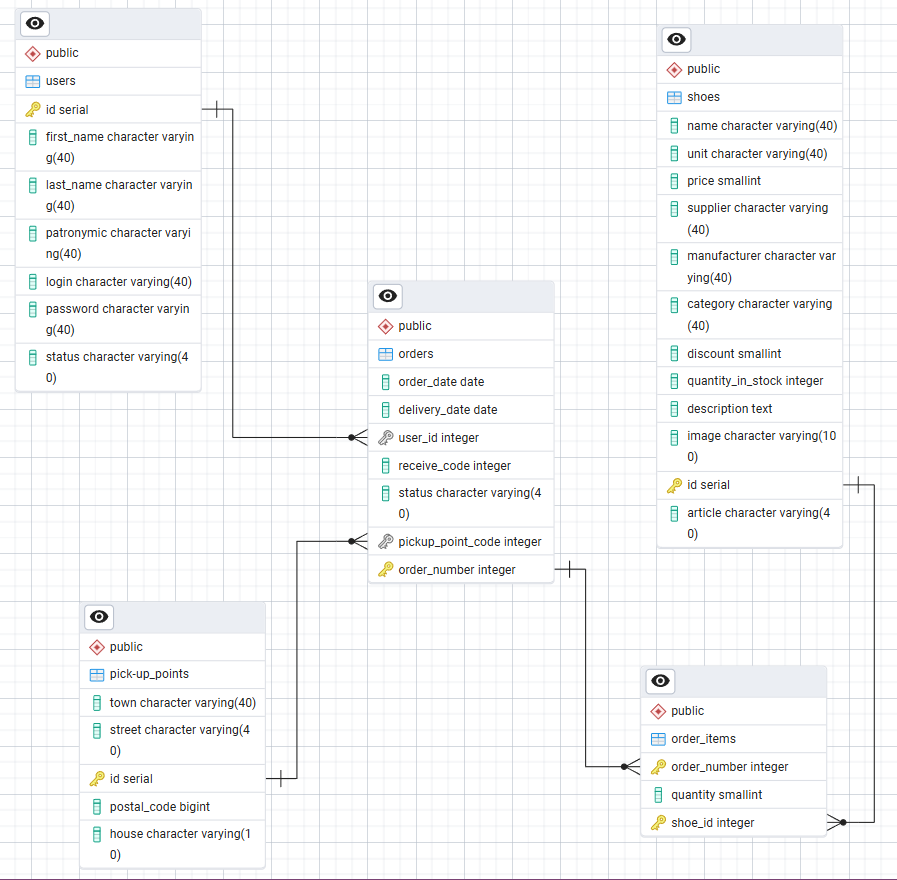

# ShoeShop — система оформления заказов обуви

Учебный проект: десктопное приложение для просмотра каталога обуви, авторизации пользователей и оформления заказов.

## Возможности

- просмотр каталога обуви с информацией о цене, скидках, наличии и характеристиках товаров;
- поиск, сортировка и фильтрация товаров;
- просмотр карточек товаров и редактирование информации о них;
- авторизация пользователей;
- оформление и просмотр заказов;
- редактирование заказов;
- управление товарами, заказами и пунктами выдачи.

## Используемые технологии

- Python 3.13;
- PostgreSQL;
- PySide6 — создание графического интерфейса;
- SQLAlchemy — взаимодействие с базой данных;
- pandas — обработка исходных данных из Excel;
- openpyxl — работа с Excel-файлами.

## Требования

- Python 3.13;
- PostgreSQL;
- библиотеки из файла `requirements.txt`.

## Установка и запуск

1. Клонировать репозиторий: `git clone <адрес репозитория>`
2. Создать окружение и установить зависимости:
 `python -m venv venv`, `venv\Scripts\activate`, `pip install -r requirements.txt`
3. Создать базу данных и загрузить скрипт `database/shoe_store.sql`.
4. Скопировать `config.ini.example` в `config.ini` и указать параметры подключения.
5. Запустить приложение: `python main.py`

## Структура проекта

- `python/` — основная часть приложения:
  - `controllers/` — обработчики авторизации, товаров, заказов и пунктов выдачи;
  - `database/` — подключение к PostgreSQL, модели данных и загрузка исходной информации;
  - `present/` — графический интерфейс приложения и изображения;
  - `main.py` — точка входа в приложение.
- `config.ini` — локальные параметры подключения к базе данных (не добавляется в Git).
- `config.ini.example` — пример файла настроек.
- `.gitignore` — список файлов и папок, исключённых из Git.
- `requirements.txt` — список зависимостей проекта.
- `shoes.iml` — конфигурация модуля PyCharm.

## Структура базы данных

База данных проекта ShoeShop предназначена для хранения информации о пользователях, товарах, заказах и пунктах выдачи.

ER-диаграмма отражает структуру базы данных, основные сущности, их атрибуты и связи между таблицами.



**Рисунок 1 — ER-диаграмма базы данных системы ShoeShop.**

## Автор

Давыдова Ксения, ПКС-44

## Запуск PostgreSQL через Docker Compose

### Предварительные требования

Для запуска проекта необходимы:

- Docker Desktop с поддержкой Docker Compose;
- Python 3.12 или совместимая версия;
- Git;
- установленные зависимости Python из `requirements.txt`.

### Подготовка конфигурации

В корневой папке проекта создайте локальный файл `.env` на основе `.env.example`.

Укажите параметры подключения к PostgreSQL:

```env
POSTGRES_DB=shoe_store
POSTGRES_USER=shoe_user
POSTGRES_PASSWORD=your_local_password
POSTGRES_HOST_PORT=5433
```

Вместо `your_local_password` укажите собственный пароль.

Файл `.env` не должен попадать в Git.

### Запуск базы данных

Из корневой папки проекта выполните:

```powershell
docker compose up -d db
```

Проверить состояние контейнера:

```powershell
docker compose ps
```

### Импорт базы данных

Если база ещё не заполнена, скопируйте SQL-файл в контейнер:

```powershell
docker compose cp ./python/database/shoe_store.sql db:/tmp/shoe_store.sql
```

Выполните импорт:

```powershell
docker compose exec db psql -v ON_ERROR_STOP=1 -U shoe_user -d shoe_store -f /tmp/shoe_store.sql
```

### Проверка подключения

Запустите диагностический сервис:

```powershell
docker compose run --rm db-check
```

При успешном подключении отображается сообщение с названием базы данных и количеством найденных таблиц.

### Подключение приложения

Локальное приложение подключается к PostgreSQL по следующим параметрам:

| Параметр | Значение |
|---|---|
| Host | localhost |
| Port | 5433 |
| Database | shoe_store |
| User | shoe_user |

Параметры подключения хранятся в локальном `config.ini`, который создаётся на основе `config.ini.example`.

Внутри Docker Compose диагностический сервис использует имя хоста `db` и порт `5432`.

### Запуск магазина

Активируйте виртуальное окружение и перейдите в папку `python`:

```powershell
.\.venv\Scripts\Activate.ps1
cd python
python main.py
```

### Остановка инфраструктуры

Для временной остановки контейнеров:

```powershell
docker compose stop
```

Для повторного запуска:

```powershell
docker compose start
```

Остановка не удаляет контейнеры и данные базы данных.